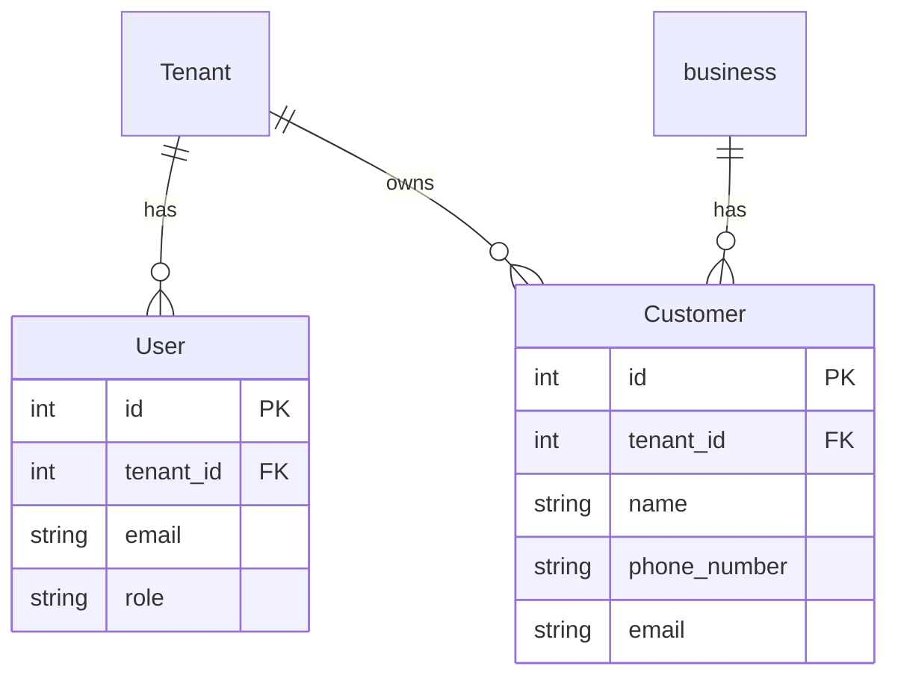

# Data model

Every table has an `id` and a `tenant_id`, and every query filters by the tenant. Add indexes for every list and search.

## Customer
- `name`: string
- `phone_number`: string
- `email`: string
- belongs to business

